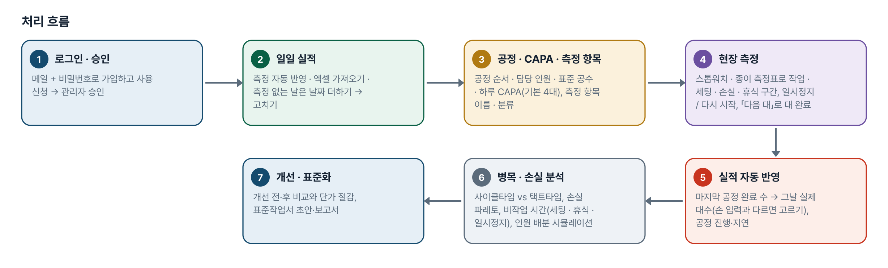
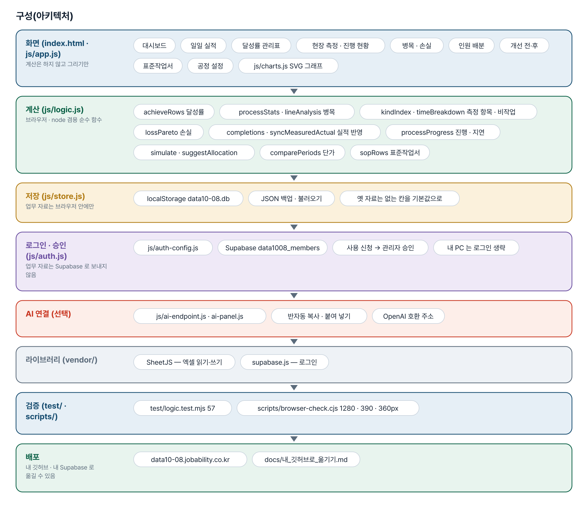
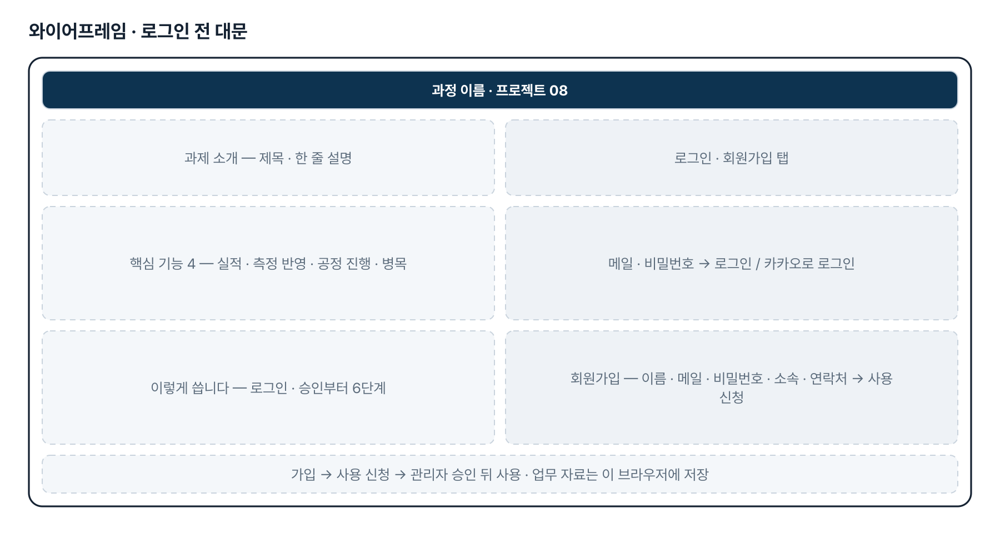
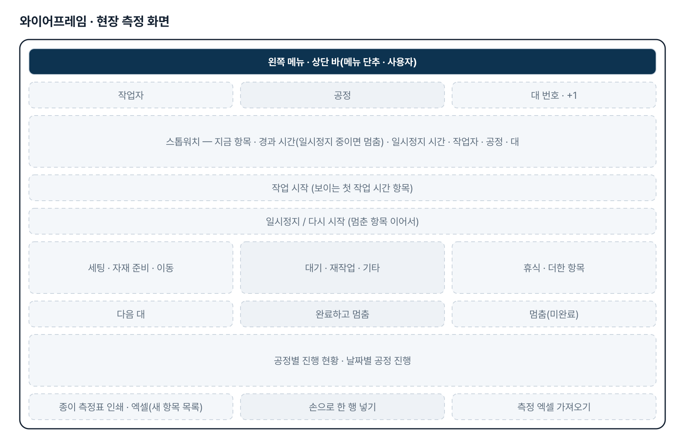
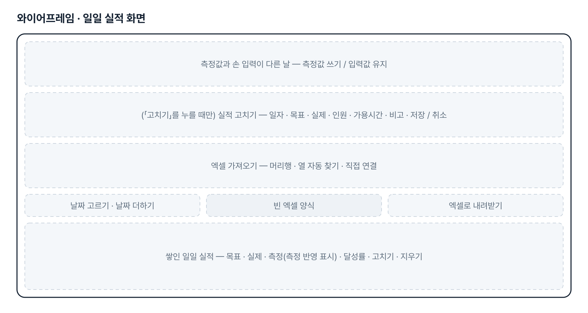
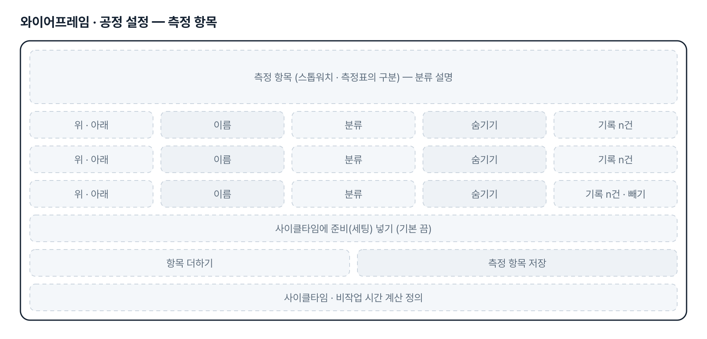
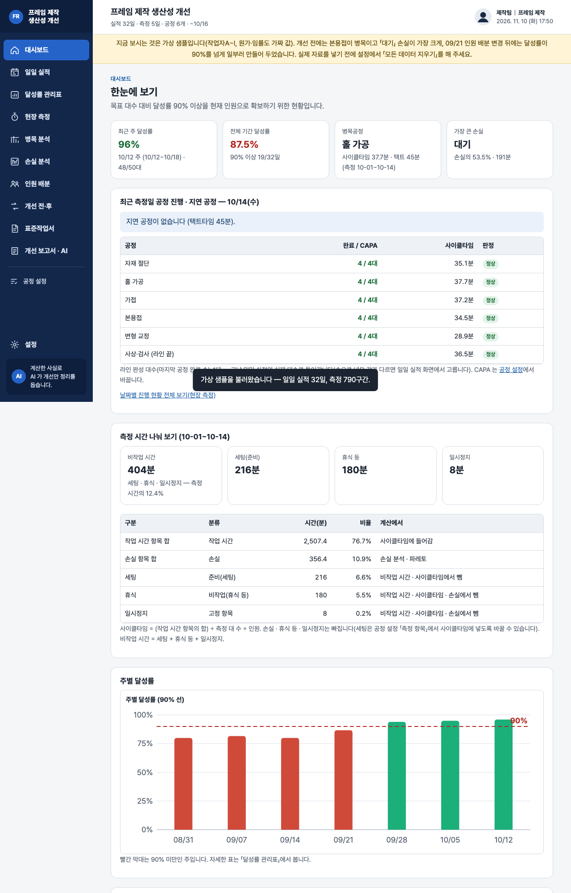

# 프레임 제작 생산성 개선 — 프로젝트 기획서 v2.3

- 기획: 박상선 · 작성일 2026-11-10 · 현장 데이터 디지털화 전문가과정 · 2차수 프로젝트 08
- 바로 쓰기: https://data10-08.jobability.co.kr/
- 워드 판: `docs/기획서/data10-08_박상선_프레임제작생산성개선_기획서_v2.3.docx`

## 개요

일일 실적과 현장 측정으로 목표 대수 대비 달성률(90% 선)을 관리하고, 공정별 작업시간·손실·병목과 인원 배분, 개선 전후 단가 절감을 분석해 표준작업서 초안까지 만드는 브라우저 도구입니다.

### 배경 · 현재 업무
- 일일 가용시간 안에 현재 인원으로 프레임 제작 목표 대수 대비 달성률을 90% 이상으로 올려야 합니다.
- 공정별 작업시간과 자재 준비·이동·대기·재작업 같은 손실시간이 따로 기록되지 않아 생산량을 막는 병목공정을 짚기 어렵습니다.
- 인원 증원 없이 작업 순서와 인원 배분을 바꿔야 하고, 바꾼 방법은 표준작업서로 남겨야 합니다.
- 현장 측정을 하고 나서 같은 완료 대수를 일일 실적에 다시 적어야 해 입력이 겹칩니다(2026-11-10 요청).

### 목표
- 날마다 목표·실제 대수를 쌓아 일·주·월 달성률과 90% 이상 일수를 바로 봅니다.
- 현장 측정으로 공정별 사이클타임과 손실을 재어 택트타임과 비교하고 병목공정을 찾습니다.
- 현장 측정 완료 대수를 일일 실적에 자동으로 넣고, 공정별 CAPA 대비 진행과 지연 공정을 보여 줍니다.
- 같은 총인원으로 인원 배분을 바꿔 보고, 개선 전후 대당 투입공수·제작원가 절감을 계산합니다.
- 개선한 작업 방법을 표준작업서 초안으로 정리합니다.

## 요구사항과 구현

| 기획서 요구 | 구현 |
|---|---|
| 가용시간 대비 목표·실제 대수, 달성률 관리표 | 일일 실적(측정 자동 반영 · 엑셀 가져오기 · 날짜 더하기 → 고치기) → 일·주·월 달성률(합 ÷ 합), 90% 선 그래프, 90% 이상 일수, 엑셀·인쇄 |
| 공정별 작업시간 분석표와 병목공정 개선안 | 현장 측정(스톱워치·종이 측정표·엑셀) → 공정별 대당 공수·사이클타임 vs 택트타임, 병목·라인 밸런스. 개선안 문장은 AI 반자동 |
| 작업 순서 및 인원 배분 개선안 | 인원 배분 시뮬레이터 + 같은 총인원 자동 배분 제안. 한 사람만 할 수 있는 작업·선후 관계는 2단계 |
| 개선 전·후 생산량과 손실시간 비교표 | 두 기간 비교 — 달성률·실제 대수·대당 투입공수·병목·손실 유형별 |
| 제작 단가 절감 효과 분석표(대당 절감액·절감률) | 대당 투입공수 × 임률 + 기타 원가(입력값 기준), 절감액·절감률·연간 절감, KPI 3개. 회사 원가 방식은 확인 후 맞춤 |
| 목표 달성을 위한 표준작업서 | 공정 설정의 순서·인원·표준 공수·작업 요점·품질/안전 → 표준작업서 초안(인쇄·Word·엑셀), AI 로 문장 다듬기 |
| 현장 측정 완료 수량을 일일 실적에 자동 기록(2026-11-10) | 「다음 대」로 끝낸 대수를 날짜 × 공정별로 세고, 마지막 공정 완료 수를 그날 실제 대수로 자동 반영. 손 입력과 다르면 덮어쓰지 않고 고르기 |
| 공정별 CAPA(예: 일 4대) 기준 진행 현황과 지연 공정(2026-11-10) | 공정 설정에 하루 CAPA(기본 4), 공정별 진행 현황 · 날짜별 공정 진행 표, 대시보드 「오늘 공정 진행 · 지연 공정」 카드 |
| 측정 항목(자재 준비 · 이동 · 대기 · 재작업 등)을 현장에 맞게 고치고 더하기(2026-11-10 v2.1) | 공정 설정 「측정 항목」 — 이름 · 분류 · 순서 · 숨기기 · 더하기. 기록은 항목 id 로 남아 이름을 바꿔도 지난 기록이 따라가고, 계산은 분류로 합니다. 측정표 인쇄 · 엑셀 · 가져오기도 새 목록을 따릅니다 |
| 일시정지 — 세팅 · 본작업 · 휴식 시간을 나눠 재기(2026-11-10 v2.1) | 스톱워치 「일시정지 / 다시 시작」, 기본 항목 「세팅」(준비) · 「휴식」(비작업). 사이클타임은 작업 시간 항목만(세팅은 설정으로 선택), 비작업 시간(세팅 · 휴식 · 일시정지)은 대시보드 · 손실 분석에 따로 요약 |
| 팀 공유 | 2단계 — 지금은 브라우저 저장 + JSON 백업 |
| 일일 실적 입력란은 실적 수정과 겹치므로 삭제(2026-11-10 요청) | 새 실적 입력 카드를 빼고 표의 「고치기」 하나로 정리. 측정이 없는 날은 「날짜 더하기」로 줄을 만든 뒤 같은 고치기 화면에서 입력 |

## 주요 기능

- **일일 실적 · 달성률** — 현장 측정 완성 대수가 날마다 자동으로 들어오고, 여러 날은 엑셀로 가져오며, 측정 없는 날은 「날짜 더하기」 → 「고치기」로 넣어 일·주·월 달성률과 90% 선을 봅니다.
- **현장 측정 → 실적 자동 반영** — 휴대폰 스톱워치로 공정별 작업 · 세팅 · 손실 · 휴식을 재고(잠깐 멈출 때는 일시정지), 「다음 대」로 끝낸 대수를 그날 실적에 자동으로 넣습니다.
- **측정 항목 편집 · 비작업 시간** — 측정 항목의 이름 · 분류 · 순서 · 숨기기를 현장에 맞게 바꾸고, 세팅 · 휴식 · 일시정지 같은 비작업 시간을 사이클타임과 따로 봅니다.
- **공정 진행 · 지연 공정** — 공정별 하루 CAPA 대비 완료 수와 사이클타임을 날짜별로 보고, 지연 공정을 빨갛게 표시합니다.
- **병목 · 손실 · 인원 배분** — 사이클타임과 택트타임으로 병목공정을, 손실 파레토로 큰 손실을 찾고 같은 인원으로 배분을 바꿔 봅니다.
- **개선 전·후 · 단가 절감** — 두 기간의 달성률·대당 투입공수·손실을 비교하고 임률·원가를 넣어 대당 절감액·절감률을 계산합니다.
- **표준작업서 · 보고서** — 공정 순서·인원·표준 공수·작업 요점으로 표준작업서 초안을, 계산한 사실로 AI 프롬프트(작업자 이름 가림)를 만듭니다.
- **로그인 · 사용 승인** — 회사 메일이나 개인 메일로 가입해 사용 신청을 하면 관리자가 승인합니다.

## 처리 흐름(파이프라인)

1. **로그인 · 승인** — 메일 + 비밀번호로 가입하고 사용 신청 → 관리자 승인
2. **일일 실적** — 측정 자동 반영 · 엑셀 가져오기 · 측정 없는 날은 날짜 더하기 → 고치기
3. **공정 · CAPA · 측정 항목** — 공정 순서 · 담당 인원 · 표준 공수 · 하루 CAPA(기본 4대), 측정 항목 이름 · 분류
4. **현장 측정** — 스톱워치 · 종이 측정표로 작업 · 세팅 · 손실 · 휴식 구간, 일시정지 / 다시 시작, 「다음 대」로 대 완료
5. **실적 자동 반영** — 마지막 공정 완료 수 → 그날 실제 대수(손 입력과 다르면 고르기), 공정 진행·지연
6. **병목 · 손실 분석** — 사이클타임 vs 택트타임, 손실 파레토, 비작업 시간(세팅 · 휴식 · 일시정지), 인원 배분 시뮬레이션
7. **개선 · 표준화** — 개선 전·후 비교와 단가 절감, 표준작업서 초안·보고서

## 구성(아키텍처)

- **화면 (index.html · js/app.js)** — 대시보드 · 일일 실적 · 달성률 관리표 · 현장 측정 · 진행 현황 · 병목 · 손실 · 인원 배분 · 개선 전·후 · 표준작업서 · 공정 설정 · js/charts.js SVG 그래프
- **계산 (js/logic.js)** — achieveRows 달성률 · processStats · lineAnalysis 병목 · kindIndex · timeBreakdown 측정 항목 · 비작업 · lossPareto 손실 · completions · syncMeasuredActual 실적 반영 · processProgress 진행 · 지연 · simulate · suggestAllocation · comparePeriods 단가 · sopRows 표준작업서
- **저장 (js/store.js)** — localStorage data10-08.db · JSON 백업 · 불러오기 · 옛 자료는 없는 칸을 기본값으로
- **로그인 · 승인 (js/auth.js)** — js/auth-config.js · Supabase data1008_members · 사용 신청 → 관리자 승인 · 내 PC 는 로그인 생략
- **AI 연결 (선택)** — js/ai-endpoint.js · ai-panel.js · 반자동 복사 · 붙여 넣기 · OpenAI 호환 주소
- **라이브러리 (vendor/)** — SheetJS — 엑셀 읽기·쓰기 · supabase.js — 로그인
- **검증 (test/ · scripts/)** — test/logic.test.mjs 57 · scripts/browser-check.cjs 1280 · 390 · 360px
- **배포** — data10-08.jobability.co.kr · docs/내_깃허브로_옮기기.md

## 화면 구성(와이어프레임)

## 규칙 · 판정 기준

- 달성률 = 실제 대수 합 ÷ 목표 대수 합(날마다 달성률의 평균이 아님). 목표 90% 이상이면 달성, 목표가 0인 날은 비웁니다.
- 택트타임(분/대) = 가용시간 × 60 ÷ 목표 대수. 사이클타임 = (작업 시간 분류 항목의 합 [+ 설정을 켜면 준비(세팅)]) ÷ 측정 대 수 ÷ 측정 인원. 손실 · 비작업(휴식 등) · 일시정지는 사이클타임에서 빠집니다. 병목은 이 사이클타임이 가장 긴 공정입니다.
- 측정 항목: 기록은 항목 id 로 저장하고 계산은 분류로 합니다 — 이름을 바꿔도 지난 기록과 계산이 그대로입니다. 옛 기록(구분 = 이름)은 기본 항목 id 와 이름이 같아 그대로 짝지어지고, 목록에 없는 구분은 지우지 않고 손실 항목으로 되살립니다. 엑셀 · 손 입력 글자는 지금 이름 → 기본 별칭 순서로 짝짓습니다.
- 손실 = 분류가 「손실」인 항목의 합(파레토 · 공정별 · 작업자별). 비작업 시간 = 준비(세팅) + 비작업(휴식 등) + 일시정지 — 대시보드 · 손실 분석에 따로 보입니다. 「일시정지」는 스톱워치 일시정지 동안의 시간으로, 일시정지 동안 지금 구간 시간은 흐르지 않습니다.
- 대 완료: 스톱워치는 「다음 대」·「완료하고 멈춤」으로 닫힌 대만 셉니다. 「대 완료」 표시가 없는 기록(종이·엑셀·옛 기록)은 작업 시간 항목 구간이 있는 대를 완료로 셉니다.
- 라인 완성 대수 = 공정 설정 순서의 마지막 공정 완료 수. 이 값이 그날 일일 실적의 실제 대수가 됩니다 — 실적이 없거나 비었거나 이미 「측정 반영」이면 자동, 손 입력과 다르면 덮어쓰지 않고 사용자가 고릅니다.
- 지연 공정 = 측정한 날 완료 수 < 하루 CAPA(기본 4대) 또는 사이클타임 > 택트타임. 측정이 없는 공정은 판정하지 않습니다.
- 대당 투입공수(인·시) = Σ(인원 × 가용시간) ÷ 실제 대수. 단가 = 대당 투입공수 × 임률 + 기타 원가(모두 입력값).
- AI 프롬프트에는 계산한 사실만 넣고 작업자 이름은 「작업자1」 별칭으로 가립니다(기본). 원가는 켤 때만 넣습니다.

## 검증

- 계산 규칙 테스트 60개 통과
- node test/logic.test.mjs 60개 — 날짜·시각 읽기, 열 찾기, 달성률, 측정·병목·손실, 배분, 단가, 스톱워치, 별칭, 저장 형식, 11-10 요청 8개(완료 셈 · 자동 반영 · CAPA 등), v2.1 요청 9개(항목 정리 · 이름 바꾸기와 엑셀 왕복 · 이름 맞바꿈 · 항목 더하기와 분류 계산 · 세팅 포함 여부 · 일시정지 · 새로 고침 후 일시정지 · 옛 자료 이전 · 가상 샘플), v2.3 요청 3개(날짜 더하기 · 측정 반영 · 빈 줄 지우기).
- 일부러 깨뜨려 확인(v2.1): 일시정지를 사이클타임에 넣으면 · 저장된 id 보다 글자를 먼저 보면 · 분류 대신 옛 손실 이름으로 세면 · 일시정지가 멈춘 항목을 잊으면 각각 해당 시험이 실패합니다. 원복 후 모두 통과.
- 일부러 깨뜨려 확인(v2.3): 날짜 더하기가 있는 날을 덮으면 · 실제 0대 줄을 빈 줄로 보면 해당 시험이 실패합니다. 원복 후 모두 통과.
- scripts/browser-check.cjs(헤드리스 Chromium) — 1280 · 390 · 360px 에서 화면 12개 가로 넘침 0, 측정 항목 이름 바꾸기 · 더하기 · 숨기기 → 스톱워치 · 기록 표 · 손실 분석에 반영, 일시정지 → 새로 고침 → 다시 시작, 세팅 포함 설정까지 모두 통과, 콘솔 오류 0. v2.3 — 일일 실적에 입력란이 없고 날짜 더하기 → 고치기 저장 · 취소(빈 줄 삭제) · 있는 날짜 열기 · 표의 고치기가 동작.

## 이번 판에서 하지 않는 것

- 업무 자료(실적·측정·공정)는 아직 팀 공유 DB 가 아니라 이 브라우저에 저장합니다. 여러 휴대폰의 측정을 모으려면 엑셀로 내보내 가져오거나 JSON 백업을 씁니다.
- 한 공정에서 여러 사람이 한 대를 나눠 잴 때는 한 사람이라도 「다음 대」를 누르면 그 대를 완료로 봅니다.
- 측정 항목은 이 브라우저에 저장됩니다. 여러 휴대폰에서 이름을 다르게 바꾸면 엑셀로 모을 때 글자로 짝지으므로, 항목 이름은 한 사람이 정해 JSON 백업으로 나눠 쓰는 것을 권합니다.
- 인원 배분은 작업을 인원끼리 나눌 수 있다고 보는 단순 모델입니다. 한 사람만 할 수 있는 작업·선후 관계는 반영하지 않습니다.
- 임률·원가는 사용자가 넣는 값으로만 계산합니다. 회사 원가 계산 방식은 확인 후 맞춥니다.
- 샘플은 모두 가상 값입니다(작업자A~I, 가짜 임률·원가).

## 다음 단계

- 팀 공유 저장 — 여러 휴대폰의 측정과 일일 실적을 한곳(요청자 Supabase)에 모으기
- 실제 실적·측정 자료로 가용시간·투입공수·원가 정의 보정, 공정별 실제 CAPA 확정
- 한 사람만 할 수 있는 작업·선후 관계를 반영한 인원 배분
- 기존 작업표준서를 근거로 표준작업서 확인

## 버전 이력

- **v2.3** (2026-11-10) — 일일 실적 「현장 실적 입력」 카드 삭제(요청: 실적 수정 기능과 겹침) — 고치기 양식은 표의 「고치기」를 누를 때만 열림 / 측정이 없는 날은 표 위 「날짜 더하기」 — 그날 줄을 만들고 바로 고치기 화면을 엶(목표는 설정 기본값, 저장하지 않고 닫으면 빈 줄 삭제) / 실적이 들어오는 길 = 현장 측정 자동 반영 · 엑셀 가져오기 · 날짜 더하기 → 고치기, 대시보드 · 진행 순서 · 빈 화면 안내 문구를 새 흐름으로
- **v2.1** (2026-11-10) — 측정 항목(구간 종류) 편집 — 공정 설정에서 이름 바꾸기 · 더하기 · 순서 · 숨기기, 항목마다 분류(작업 시간 · 준비(세팅) · 손실 · 비작업(휴식 등)) / 기본 항목에 「세팅」(준비) · 「휴식」(비작업) 추가, 기록은 항목 id 로 저장 — 이름을 바꿔도 지난 기록이 따라가고 계산은 분류로 유지 / 스톱워치 「일시정지 / 다시 시작」 — 멈춘 시간은 「일시정지」로 따로 기록(사이클타임 · 손실에서 빠짐), 새로 고쳐도 이어짐 / 사이클타임 = 작업 시간 항목 합(+ 설정에 따라 세팅) ÷ 대 수 ÷ 인원 — 화면 안내 · 기획서 규칙에 정의 / 대시보드 · 손실 분석 · 보고서 · AI 프롬프트에 「비작업 시간(세팅 · 휴식 · 일시정지)」 요약
- **v2.0** (2026-11-10) — 최종 기획서 — 파이프라인 · 아키텍처 · 와이어프레임 정리 / 로그인 · 사용 신청 · 관리자 승인(요청자 Supabase 로 옮길 수 있게) / 로그인 전 대문 / 현장 측정 완료 대수 → 일일 실적 자동 반영(손 입력은 덮어쓰지 않고 고르기) / 공정별 하루 CAPA(기본 4) · 공정별 진행 현황 · 지연 공정 · 대시보드 카드
- **v1.1** (2026-10-27) — 판 맞추기 — 모든 js·css ?v= · fresh-guard · 옛 파일과 새 파일이 섞이면 새로고침 안내 / 리포 비공개 전환 안내(2026-10-26)
- **v1.0** (2026-10-20) — 1단계 — 일일 실적 · 달성률 관리표 · 현장 측정(스톱워치 · 빈 측정표) · 병목 · 손실 · 인원 배분 · 개선 전후 단가 · 표준작업서 · AI 프롬프트 / 가상 샘플(일일 실적 7주 · 측정 5일) · 기획서 v0.1
